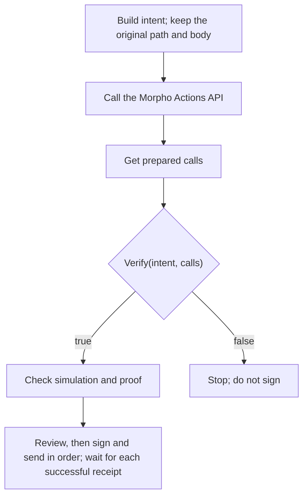

# Morpho Actions Verifier for Go

Check that the wallet calls returned by the [Morpho Actions API][actions-api]
match the action your app requested. `Verify` returns `true` or `false`
synchronously in memory. It makes no network calls and does not simulate or
submit transactions.

## Install

Use Go 1.25.1 or newer. Until there is a release tag, install from `dev`:

```sh
go get github.com/morpho-org/actions-verifier-go@dev
```

Import it as package `verifier`.

## Quick start



1. Save the concrete endpoint path and original JSON body before you send
   the request. Use the path only, not a route template or full URL.
2. Call the Actions API. For a response that needs a continuation, follow
   the [API's response checks][verify-responses] before signing any typed
   data. Verify the final calls against the **original** request, not the
   continuation body.
3. Once the status is `prepared`, pass the full `data.calls` list in the
   returned order. If verification fails or the response is not prepared,
   do not sign or send transaction calls.
4. After verification and the API's separate simulation and proof checks,
   show the calls for review. If approved, sign and send them in order
   from the requested account on the requested chain. Wait for each transaction
   to confirm with a successful receipt before sending the next. Alternatively,
   use EIP-5792 `wallet_sendCalls` with `atomicRequired: true` if the wallet
   supports atomic batching on that chain. Call entries do not encode the
   transaction sender or chain.

```go
package integration

import (
    "encoding/json"

    "github.com/morpho-org/actions-verifier-go"
)

func matchesPreparedCalls(path string, requestBody, responseBody []byte) bool {
    var response struct {
        Data struct {
            Status string          `json:"status"`
            Calls  []verifier.Call `json:"calls"`
        } `json:"data"`
    }
    if json.Unmarshal(responseBody, &response) != nil || response.Data.Status != "prepared" {
        return false
    }
    return verifier.Verify(verifier.Intent{Path: path, Body: requestBody}, response.Data.Calls)
}
```

The [API reference][actions-api] lists endpoint paths, authentication
requirements, and how to request an API key.

## What a result means

`true` means the calls passed the implemented structural checks: permitted
call kinds, order, targets and selectors; canonical ABI arguments; matching
market or vault and exact amounts where encoded; supported prerequisites;
and allowed native value. Known multicalls are checked one level down.
Unrecognized routes, selectors, and chains fail closed.

It does **not** establish that the transaction will succeed, that the
account has the needed balance or allowance, that price or position state
is current, that an expiry has not passed, or that state-derived share and
asset quantities or price bounds are right. An `all` request checks the
structural exit path, not the actual position size. Vault V2 exit penalty
limits in the request are not enforced by this verifier; the exit calldata
does not encode the maximum penalty. Embedded permit and
authorization signatures are not verified. API attribution with no origin
specified in the request is not authenticated.

For vault deposits, the underlying ERC-20 is not identified by the request
or the bundle arguments. A deposit can have no approval, one approval, or
the SDK's zero-reset sequence: an approval for zero immediately followed by
a positive approval for the same token and spender. The spender must be the
pinned deposit bundle, and the token cannot be a pinned Morpho contract or
the intended vault. The final approval can grant up to the requested assets
or the SDK's unlimited allowance (`maxUint256`). An unlimited approval can
outlast the transaction. A passing result cannot establish that the token
chosen by the response is the vault's underlying asset or that an approval
was necessary.
Where the loan or collateral token is in market parameters that hash to
the requested market ID, the approval target must match that token. Blue
funding paths accept the SDK's persistent approvals to the pinned spender,
as well as the approval amount derived from the verified call.

For Midnight offer publication, the compressed payload is opaque. A passing
check does not establish the published offer terms, tree root, validity
period, or cap represented by the payload. Wallet-funded lend and repay
publications can omit the token identity from the main call. An optional
single approval must target an unpinned token and match the loan token if
the intent supplies it. It must approve Midnight as spender, either up to
the requested amount or for the SDK's unlimited allowance (`maxUint256`).
If the intent omits the loan token, the response supplies the token address;
a passing check does not establish that it is the intended loan token.
For Midnight fills, callback and ratifier data, counterparty validity, and
relative quote guards are not verified. An optional market or maker on a
group take is checked when supplied; otherwise the group is checked but the
market and maker cannot independently be identified from the request. Without
an absolute guard that binds the take direction, the verifier checks the
response's direction for internal consistency but cannot authenticate it.
Cancellation and funding withdrawal have no onchain deadline. The verifier
cannot establish that a funding address belongs to the account, or that the
funding shares in the call are the full position.

## Supported route families

| Family | Actions | Supported chain IDs |
| --- | --- | --- |
| Blue | borrow, refinance, repay, supply, supply-collateral, withdraw, withdraw-collateral | 1, 10, 130, 137, 143, 196, 480, 988, 999, 4217, 4663, 5042, 8453, 42161, 747474 |
| Vault V1 | deposit, withdraw | 1, 10, 130, 137, 143, 480, 988, 999, 8453, 42161, 747474 |
| Vault V2 | deposit, force-withdraw, redeem-in-kind, withdraw | Same as Blue |
| Midnight markets | borrow, lend, repay, supply-collateral, withdraw, withdraw-collateral | 1, 4663, 5042, 8453 |
| Midnight offer groups | take | Same as Midnight markets |
| Midnight offers | borrow, cancel, funding/withdraw, lend, repay, withdraw | Same as Midnight markets |

These are the verifier's supported chain and route combinations, not a promise
that a particular market, vault, or API request is available. Contract addresses
are listed in [chains_blue_vault.json](chains_blue_vault.json) and
[chains_midnight.json](chains_midnight.json).

## Update safely

Pin an exact Go module version for reproducible builds: use a release tag
when available, or keep the pseudo-version recorded by `go get`.
When upgrading, rerun your integration tests against the routes and chains
you use. Go module major versions are independent of the HTTP API version;
the `/v0/actions` path does not determine the Go import path.

## Tests

The standard test suite uses local fixtures and needs no API key.

```sh
go test ./...
go vet ./...
go test -race ./...
```

### Optional live API test

The live test is skipped unless `ACTIONS_API_URL` is set. Set it to the
base URL listed in the [Actions API reference][actions-api], without an
endpoint path. Export `ACTIONS_API_KEY` from your secret store if the endpoint
requires one. Create a JSON array of intents (each with `path` and `body`)
for markets, vaults, and accounts with the state your actions require.
Do not put credentials in that file.

```sh
ACTIONS_API_CASES=/path/to/cases.json go test -run '^TestLiveActions$' -count=1 -v
```

For a local Actions API use its loopback URL and omit the key if it is not
required. The test sends only preparation requests. It does not sign or
broadcast transactions, save responses, or print headers. A non-prepared
response is reported separately from a prepared response rejected by
`Verify`; an authentication failure stops further requests to that host.

[actions-api]: https://docs.morpho.org/api/#action-api
[verify-responses]: https://docs.morpho.org/api/actions/verify-responses/
